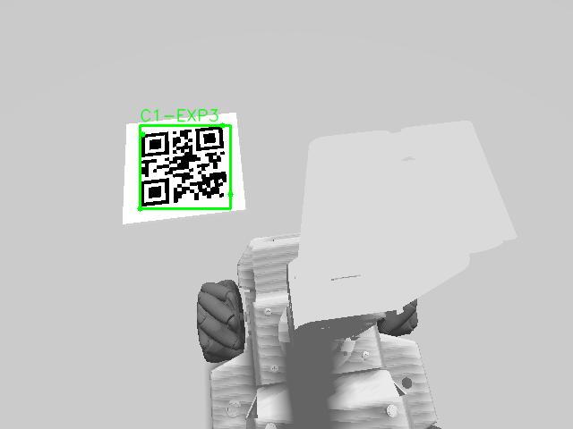

# EXP3 二维码生成与识别

**验收目标**是自己写一段文字、从生成的 PNG 原样读回，再让相机读到同样的内容。先做下面的离线两步，即使没有连接相机也能检查生成和检测算法。课程命令里的 `python` 在 Ubuntu 22.04 下可写为 `python3`。[课程 EXP-03 原理、实操、互动演示及小测](https://course-generate-agent.pages.dev/courses/core/exp001-robot-vision/exp-03-qrcode/index.html)

## 一、准备环境

Ubuntu 22.04 下安装离线实验所需的 Python 库。系统的 OpenCV 与后面用于 ROS 的 `cv_bridge` 共用。课程入口也会检查 MJPEG 库，下面单独安装它，避免 pip 额外装一套 OpenCV。

```bash
sudo apt update
sudo apt install python3-pip python3-opencv python3-numpy python3-qrcode python3-pil \
  python3-yaml python3-pyzbar python3-aiohttp python3-netifaces
python3 -m pip install --user --no-deps mjpeg-streamer==2024.2.8
```

从仓库根目录进入实验目录。以下生成和读回命令共用这个目录，输出文件写入当前目录。

```bash
cd src/xflz_eai_car1/vision/04_qrcode
```

## 二、按课程顺序操作

**1. 生成二维码。** 可把引号内的网址换成学号、库位号或中文。脚本打印图片的保存位置。

```bash
python3 src/app.py --generate "https://example.com" --save my_qr.png
```

**2. 图片读回。** 终端应打印 `[QR] https://example.com`，并生成标注图 `out.png`。打开它，检查绿框是否套住二维码。换一段自己的文字重复两步，逐字比对终端输出。需要本地窗口时加 `--display`，按任意键关闭静态图窗口。

```bash
python3 src/app.py --detect --image my_qr.png --save out.png
```

**3. 实时扫描。** 先启动一种图像源。虚拟机使用下一节的 Gazebo 命令。迁移到已安装 HP60C 驱动的真机时，在仓库根目录打开终端一，运行课程相机驱动。

```bash
source /opt/ros/humble/setup.bash
source install/setup.bash
ros2 launch ascamera hp60c.launch.py
```

真机终端二也从仓库根目录开始。将打印的码或显示二维码的手机放在镜头前。这里只启动相机和识别程序。

```bash
source /opt/ros/humble/setup.bash
source install/setup.bash
cd src/xflz_eai_car1/vision/04_qrcode
python3 src/app.py --detect --ros
```

在运行程序的机器打开 <http://localhost:8080/>，点击 `/qrcode.mjpg`。每次成功解码，终端输出一行 `[QR]` 和完整文字。每处理 30 帧报告一次实测帧率。镜头移开后画面继续刷新。按 Ctrl+C 停止。如需从宿主机看虚拟机的流，使用 `--host <虚拟机可达的网卡地址>`，浏览器打开程序打印的地址。端口可用 `--port 8090` 更改。

## 三、Gazebo 仿真与 RQT

Ubuntu 22.04 配置好 ROS 2 Humble 软件源后，从仓库根目录执行。固定相机模式加载已有的 0.22 m 二维码板，板上编码为 `C1-EXP3`，四周保留四格白边。该模式不启动运动控制器。[相机仿真与 VMware 图形配置](CAMERA_SIMULATION.md)

```bash
sudo apt install python3-colcon-common-extensions ros-humble-ros-gz ros-humble-xacro \
  ros-humble-joint-state-publisher ros-humble-robot-state-publisher \
  ros-humble-cv-bridge ros-humble-rqt-image-view
source /opt/ros/humble/setup.bash
colcon build --symlink-install --packages-select car1_description car1_gazebo car1_app
source install/setup.bash
ros2 launch car1_gazebo grasp_demo_vision.launch.py \
  camera_only:=true fortress:=true camera_target:=exp03_qrcode_target
```

终端二在仓库根目录运行。等 `ros2 topic hz` 打印帧率后，按 Ctrl+C 结束测量，再启动识别。

```bash
source /opt/ros/humble/setup.bash
source install/setup.bash
ros2 topic hz /camera/image
cd src/xflz_eai_car1/vision/04_qrcode
python3 src/app.py --detect --ros --topic /camera/image
```

终端三同样加载 Humble 和工作区。用 RQT 的下拉框先选 `/camera/image` 看原图，再选 `/exp03_qrcode_detection/result` 看标注图。也可选 `/exp03_qrcode_detection/mask` 查看四角连成的边界。MJPEG 网页和 RQT 显示同一帧的检测结果。

```bash
source /opt/ros/humble/setup.bash
source install/setup.bash
ros2 topic info -v /camera/image
ros2 topic echo /exp03_qrcode_detection/detections std_msgs/msg/String --once
ros2 run rqt_image_view rqt_image_view
```

相机输入类型为 `sensor_msgs/msg/Image`，节点使用传感器 QoS。输出图像保留源时间戳和 `frame_id`。检测话题的 `data` 是 JSON，每个目标有 `corners`（四个原图像素坐标）、`decoded` 和 `content`。空画面仍输出 `detections: []`；定位成功但解码失败时显示橙框，`content` 为 `null`。正常解码时，网页和 RQT 上出现绿框，终端读到 `[QR] C1-EXP3`。

**已有 ROS launch 入口**也可单独用于 RQT，选择它时先退出课程扫描程序，以免两个同名节点同时发布。下面使用已安装的 641×481 样例，预期四角约为 (217,133)、(426,133)、(426,342)、(217,342)。省略 `image_path` 即订阅仿真相机。

```bash
ros2 launch car1_app exp03_qrcode_detection.launch.py \
  image_path:="$(ros2 pkg prefix --share car1_app)/images/exp03_qrcode.png"
```

## 四、从课程原理找到源码

| 课程知识点 | 本项目对应代码与观察方法 |
|---|---|
| 生成 | `vision/04_qrcode/src/app.py` 中的 `generate_qr` 调用 `QRCode → add_data → make(fit=True) → make_image`。版本从 1 起步，容量不够会自动升版。最后将 RGB 转为 OpenCV 使用的 BGR。 |
| 定位、摆正、解码 | `app/car1_app/car1_app/qrcode_detection.py` 中的 `QrCodeDetector.detect` 按比例缩放，调用 `cv2.QRCodeDetector.detectAndDecode`。三个定位图案帮助确定方向，四角限定透视校正区域，库从摆正后的格子恢复数据并纠错。 |
| 回算原图坐标 | 缩放图四角按原图与工作图的实际宽高比分别还原，再补偿像素中心偏移。原点在左上，横坐标向右、纵坐标向下。矩形用于看标注，`corners` 给出斜拍时的真实四边形。 |
| 多码与显示 | 每次在工作图涂白已找到的区域，再找下一个，每帧最多 8 次。在原图画绿色矩形和角点，超过 40 字符的标签显示前 37 字符加省略号。终端和 JSON 保留完整解码文本。 |
| 实时输入和输出 | `vision/04_qrcode/src/live_scan.py` 复用 `car1_app` 的 EXP3 节点与 `image_experiment.py` 发布结果，并用课程的 `mjpeg_streamer` 将标注帧送到网页。 |
| Humble 兼容 | 部分 Ubuntu OpenCV 构建缺少 QUIRC。取得四角但解码为空时，已有的兼容实现从原图矫正该区域，补白边后交给 ZBar。透视校正无法补回原始画面已丢失的细节。 |

## 五、调参、互动对照与常见问题

在实验目录复制配置，用副本做实验。改完后重新运行相应命令。ROS launch 的检测比例则由包内的 `config/exp03_qrcode_detection.yaml` 设置，可用 `config_file:=配置文件完整路径` 覆盖。

```bash
cp config/qrcode_config.yaml my_config.yaml
python3 src/app.py --generate "https://example.com" --config my_config.yaml --save trial.png
python3 src/app.py --detect --image trial.png --config my_config.yaml --save trial-out.png
```

- **比较纠错等级。** 默认 `generate.error_correction: M`。对同一段文字分别试 L、M、Q、H，每次重新生成并读回，对照课程互动演示看密度变化。纠错等级越高，可恢复的错误通常越多，但相同尺寸的码可能变得更密。挡住定位角标可能使定位先失败。
- **比较距离与缩放。** 默认 `detect.scale: 0.5` 把宽高各缩一半，处理像素约为原来的四分之一。把同一张远距离图片分别按 0.5 和 1.0 读回；若只有 1.0 能读出，说明缩小后每个模块的有效像素不足。默认每格 `box_size: 5` 像素，`border: 4` 格。打印时可以加大模块，并保留静区和深色前景。
- **出现 `cannot open ros topic`。** 默认等首帧 5 秒。检查 `source.ros.rgb_topic`、相机是否启动以及 `ros2 topic hz` 是否有输出。HP60C 默认订阅 `/ascamera_hp60c/camera_publisher/rgb0/image`，Gazebo 用 `/camera/image`。
- **只有橙框或没有框。** 有橙框说明找到了四角。检查解码库、反光和清晰度。无框先看原图里是否有完整的码，多个小码同框时也可提高 `detect.scale`。OpenCV 的 `putText` 使用内置西文字体，中文标签可能显示问号，可在终端或 JSON 查看原文。
- **网页打不开或端口占用。** 核对程序打印的主机和端口。Ubuntu 的 `python3` 需能导入 `mjpeg_streamer`、`aiohttp`、`netifaces`。只有 ROS launch 入口运行时用 RQT 查看；网页由课程的 `--detect --ros` 入口提供。

## 六、本阶段实测与边界

下图取自 Ubuntu 22.04／ROS 2 Humble／Ignition Fortress 的 `/exp03_qrcode_detection/result` 消息。可以对照黑白模块、白边、车体边缘和绿色标注的位置。



| 检查 | 实际结果 |
|---|---|
| 生成和读回 | 按课程默认值生成 `https://example.com`，得到 165×165 PNG，再读回相同网址。中文 `库位-甲3` 也逐字读回。改用 H 级、每格 8 像素及 1.0 检测比例，同一网址生成 296×296 图像并成功读回。 |
| 构建和回归 | Humble 中 `car1_app`、`car1_description`、`car1_gazebo` 三包构建成功。三个实验的 18 项测试通过，覆盖单码、双码、空画面、数据区损坏、坐标回映射等。 |
| ROS 与网页 | 用 ROS 图像发布器先发二维码再发空白帧，收到带标注结果及空检测列表。分别检查了网页索引、MJPEG 响应类型和流中的 JPEG 图像。 |
| 仿真渲染修复 | 原相机帧中白板右侧被车体遮挡，且可见白板上没有黑色模块，Fortress 日志报告 OBJ 缺少材质。为黑色网格补上材质、法线和 UV，将板向车左移 0.18 m。重新启动同一场景后，默认半分辨率检测实际解出 `C1-EXP3`。一次 640×480 原帧测得四角约为 (159,150)、(248,140)、(257,217)、(156,233)。 |
| RQT | 在虚拟 X 显示器启动 RQT Image View 并打开结果话题，窗口中可见二维码、绿色边框和 `C1-EXP3` 标签。验收读数取自原始 ROS 图像及检测消息。 |
| 待真机核对 | 本次使用软件渲染。未连接 HP60C，也未在 VMware 桌面实测帧率或宿主机到虚拟机的网络访问。 |
